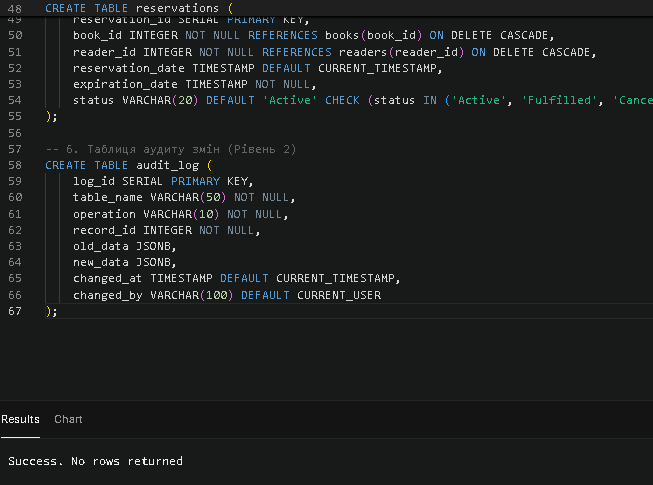
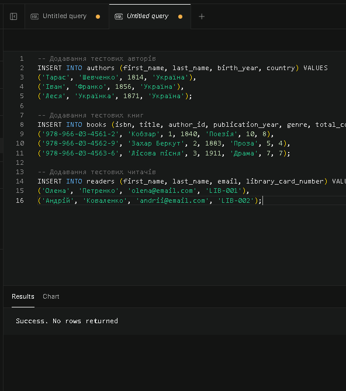
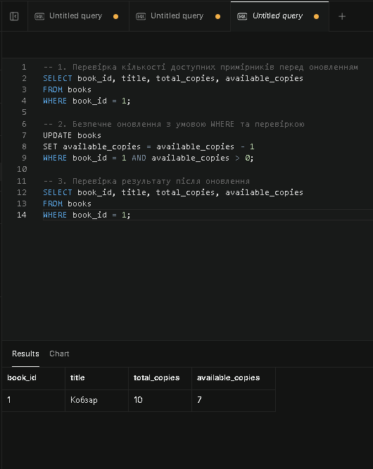
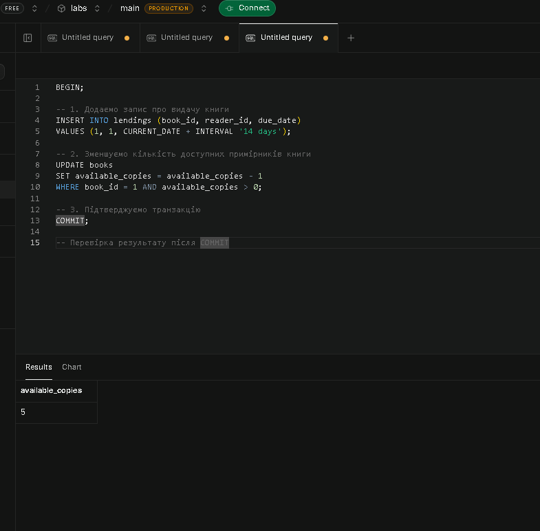
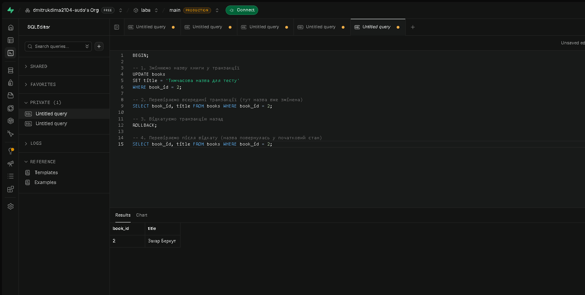
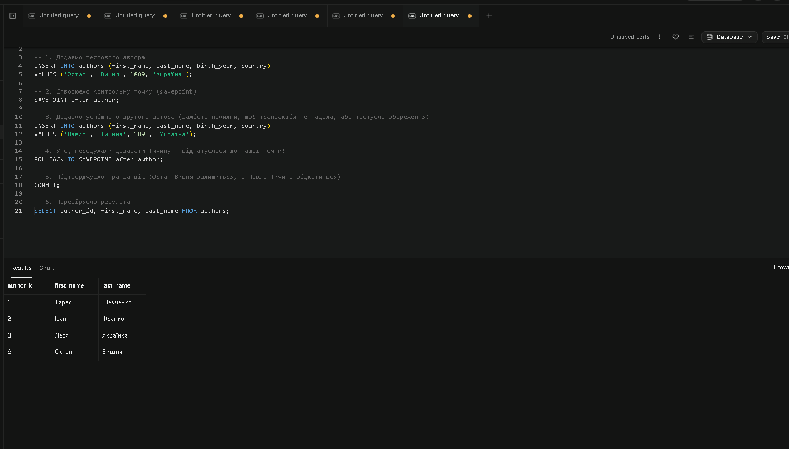
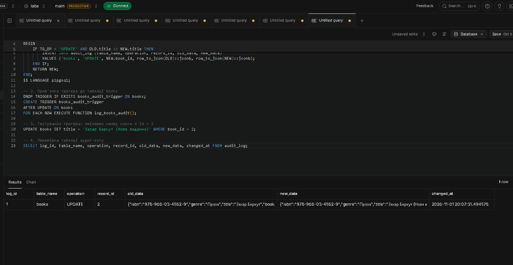

# ЗВІТ з лабораторної роботи №3
### «Модифікація даних та транзакції»

**Виконав:** студент групи ІПЗ-21, Дмитрук Дмитро  
**Варіант:** Система управління бібліотекою  
**База даних:** PostgreSQL (платформа Supabase), схема `library_lab3`  

---

## 🎯 Мета роботи
Здобути практичні навички безпечної модифікації даних у реляційних базах даних, опанувати механізми транзакцій для забезпечення цілісності даних, навчитися працювати з обмеженнями цілісності та тригерами при зміні взаємопов'язаних записів.

---

## 🛠️ Виконання роботи

### Рівень 1 & 2. Практична реалізація

#### Крок 1. Створення структури бази даних
Створено реляційну схему управління бібліотекою з основними таблицями (`authors`, `books`, `readers`, `lendings`, `reservations`, `audit_log`) та відповідними обмеженнями цілісності (`PRIMARY KEY`, `FOREIGN KEY`, `CHECK`, `UNIQUE`, `NOT NULL`).

**SQL-скрипт створення таблиць:**

```sql
DROP TABLE IF EXISTS audit_log CASCADE;
DROP TABLE IF EXISTS reservations CASCADE;
DROP TABLE IF EXISTS lendings CASCADE;
DROP TABLE IF EXISTS readers CASCADE;
DROP TABLE IF EXISTS books CASCADE;
DROP TABLE IF EXISTS authors CASCADE;

CREATE TABLE authors (
    author_id SERIAL PRIMARY KEY,
    first_name VARCHAR(50) NOT NULL,
    last_name VARCHAR(50) NOT NULL,
    birth_year INTEGER CHECK (birth_year >= 1000 AND birth_year <= 2026),
    country VARCHAR(50),
    created_at TIMESTAMP DEFAULT CURRENT_TIMESTAMP
);

CREATE TABLE books (
    book_id SERIAL PRIMARY KEY,
    isbn VARCHAR(17) UNIQUE NOT NULL,
    title VARCHAR(200) NOT NULL,
    author_id INTEGER NOT NULL REFERENCES authors(author_id) ON DELETE RESTRICT,
    publication_year INTEGER CHECK (publication_year >= 1450),
    genre VARCHAR(50),
    total_copies INTEGER DEFAULT 1 CHECK (total_copies >= 0),
    available_copies INTEGER DEFAULT 1 CHECK (available_copies >= 0),
    created_at TIMESTAMP DEFAULT CURRENT_TIMESTAMP,
    CHECK (available_copies <= total_copies)
);

CREATE TABLE readers (
    reader_id SERIAL PRIMARY KEY,
    first_name VARCHAR(50) NOT NULL,
    last_name VARCHAR(50) NOT NULL,
    email VARCHAR(100) UNIQUE NOT NULL,
    phone VARCHAR(20),
    library_card_number VARCHAR(20) UNIQUE NOT NULL,
    registration_date DATE DEFAULT CURRENT_DATE,
    status VARCHAR(20) DEFAULT 'Active' CHECK (status IN ('Active', 'Blocked', 'Inactive'))
);

CREATE TABLE lendings (
    lending_id SERIAL PRIMARY KEY,
    book_id INTEGER NOT NULL REFERENCES books(book_id) ON DELETE RESTRICT,
    reader_id INTEGER NOT NULL REFERENCES readers(reader_id) ON DELETE RESTRICT,
    lending_date DATE DEFAULT CURRENT_DATE,
    due_date DATE NOT NULL CHECK (due_date > lending_date),
    return_date DATE CHECK (return_date IS NULL OR return_date >= lending_date)
);

CREATE TABLE reservations (
    reservation_id SERIAL PRIMARY KEY,
    book_id INTEGER NOT NULL REFERENCES books(book_id) ON DELETE CASCADE,
    reader_id INTEGER NOT NULL REFERENCES readers(reader_id) ON DELETE CASCADE,
    reservation_date TIMESTAMP DEFAULT CURRENT_TIMESTAMP,
    expiration_date TIMESTAMP NOT NULL,
    status VARCHAR(20) DEFAULT 'Active' CHECK (status IN ('Active', 'Fulfilled', 'Cancelled', 'Expired'))
);

CREATE TABLE audit_log (
    log_id SERIAL PRIMARY KEY,
    table_name VARCHAR(50) NOT NULL,
    operation VARCHAR(10) NOT NULL,
    record_id INTEGER NOT NULL,
    old_data JSONB,
    new_data JSONB,
    changed_at TIMESTAMP DEFAULT CURRENT_TIMESTAMP,
    changed_by VARCHAR(100) DEFAULT CURRENT_USER
);
```

**Результат створення структури:**



---

#### Крок 2. Додавання тестових даних
Виконано вставку початкового набору даних у таблиці за допомогою оператора `INSERT INTO`.

**SQL-скрипт додавання даних:**

```sql
INSERT INTO authors (first_name, last_name, birth_year, country) VALUES
('Тарас', 'Шевченко', 1814, 'Україна'),
('Іван', 'Франко', 1856, 'Україна'),
('Леся', 'Українка', 1871, 'Україна');

INSERT INTO books (isbn, title, author_id, publication_year, genre, total_copies, available_copies) VALUES
('978-966-03-4561-2', 'Кобзар', 1, 1840, 'Поезія', 10, 8),
('978-966-03-4562-9', 'Захар Беркут', 2, 1883, 'Проза', 5, 4),
('978-966-03-4563-6', 'Лісова пісня', 3, 1911, 'Драма', 7, 7);

INSERT INTO readers (first_name, last_name, email, library_card_number) VALUES
('Олена', 'Петренко', 'olena@email.com', 'LIB-001'),
('Андрій', 'Коваленко', 'andrii@email.com', 'LIB-002');
```

**Результат вставки:**



---

#### Крок 3. Безпечне оновлення записів
Продемонстровано важливість перевірки поточного стану та обов'язкового використання умови `WHERE` при оновленні записів за допомогою `UPDATE`.

**SQL-скрипт оновлення з перевіркою:**

```sql
-- 1. Перевірка кількості доступних примірників перед оновленням
SELECT book_id, title, total_copies, available_copies 
FROM books 
WHERE book_id = 1;

-- 2. Безпечне оновлення з умовою WHERE та перевіркою наявності
UPDATE books
SET available_copies = available_copies - 1
WHERE book_id = 1 AND available_copies > 0;

-- 3. Перевірка результату після оновлення
SELECT book_id, title, total_copies, available_copies 
FROM books 
WHERE book_id = 1;
```

**Результат оновлення:**



---

#### Крок 4. Операції з транзакціями
Процес видачі книги читачу реалізовано як єдину атомарну транзакцію із застосуванням операторів `BEGIN` та `COMMIT`.

**SQL-скрипт транзакції видачі:**

```sql
BEGIN;

-- 1. Додаємо запис про видачу книги
INSERT INTO lendings (book_id, reader_id, due_date)
VALUES (1, 1, CURRENT_DATE + INTERVAL '14 days');

-- 2. Зменшуємо кількість доступних примірників книги
UPDATE books
SET available_copies = available_copies - 1
WHERE book_id = 1 AND available_copies > 0;

-- 3. Підтверджуємо транзакцію
COMMIT;

-- Перевірка результату після COMMIT
SELECT available_copies FROM books WHERE book_id = 1;
```

**Результат виконання транзакції:**



---

#### Крок 5. Демонстрація ROLLBACK
Показано механізм відкату транзакції при скасуванні внесення змін за допомогою команди `ROLLBACK`.

**SQL-скрипт відкату транзакції:**

```sql
BEGIN;

-- 1. Змінюємо назву книги у транзакції
UPDATE books 
SET title = 'Тимчасова назва для тесту' 
WHERE book_id = 2;

-- 2. Перевіряємо всередині транзакції (назва змінена)
SELECT book_id, title FROM books WHERE book_id = 2;

-- 3. Відкатуємо транзакцію назад
ROLLBACK;

-- 4. Перевіряємо після відкату (назва повернулась у початковий стан)
SELECT book_id, title FROM books WHERE book_id = 2;
```

**Результат відкату:**



---

#### Крок 6. Використання SAVEPOINT
Продемонстровано частковий відкат транзакції до контрольної точки без повного скасування транзакції.

**SQL-скрипт роботи з SAVEPOINT:**

```sql
BEGIN;

-- 1. Додаємо тестового автора
INSERT INTO authors (first_name, last_name, birth_year, country) 
VALUES ('Остап', 'Вишня', 1889, 'Україна');

-- 2. Створюємо контрольну точку (savepoint)
SAVEPOINT after_author;

-- 3. Додаємо другого автора
INSERT INTO authors (first_name, last_name, birth_year, country) 
VALUES ('Павло', 'Тичина', 1891, 'Україна');

-- 4. Відкатуємося тільки до нашої точки
ROLLBACK TO SAVEPOINT after_author;

-- 5. Підтверджуємо транзакцію
COMMIT;

-- 6. Перевіряємо результат
SELECT author_id, first_name, last_name FROM authors;
```

**Результат використання SAVEPOINT:**



---

#### Крок 7. Тригери для аудиту змін (Рівень 2)
Створено тригерну функцію та тригер для автоматичного ведення журналу аудиту змін у таблиці `books` із збереженням старих і нових даних у форматі `JSONB`.

**SQL-скрипт створення тригера аудиту:**

```sql
-- 1. Створення функції тригера для логування змін
CREATE OR REPLACE FUNCTION log_books_audit() 
RETURNS TRIGGER AS $$
BEGIN
    IF TG_OP = 'UPDATE' AND OLD.title <> NEW.title THEN
        INSERT INTO audit_log (table_name, operation, record_id, old_data, new_data)
        VALUES ('books', 'UPDATE', NEW.book_id, row_to_json(OLD)::jsonb, row_to_json(NEW)::jsonb);
    END IF;
    RETURN NEW;
END;
$$ LANGUAGE plpgsql;

-- 2. Прив'язка тригера до таблиці books
DROP TRIGGER IF EXISTS books_audit_trigger ON books;
CREATE TRIGGER books_audit_trigger 
AFTER UPDATE ON books 
FOR EACH ROW EXECUTE FUNCTION log_books_audit();

-- 3. Тестування тригера: змінюємо назву книги з id = 2
UPDATE books SET title = 'Захар Беркут (Нове видання)' WHERE book_id = 2;

-- 4. Перевірка таблиці аудит-логу
SELECT log_id, table_name, operation, record_id, old_data, new_data, changed_at FROM audit_log;
```

**Результат роботи тригера аудиту:**



---

## ❓ Контрольні запитання та відповіді

#### 1. У чому полягає різниця між операторами INSERT, UPDATE та DELETE? Які обмеження необхідно враховувати при їх використанні?
* **Різниця:**
  * `INSERT` використовується для **додавання** нових рядків до таблиці.
  * `UPDATE` призначений для **зміни** значень наявних записів.
  * `DELETE` видаляє існуючі рядки з таблиці.
* **Обмеження, які необхідно враховувати:**
  * Порушення унікальності первинних (`PRIMARY KEY`) та унікальних (`UNIQUE`) ключів.
  * Порушення зовнішніх ключів (`FOREIGN KEY`) при зміні/видаленні батьківських записів або додаванні дочірніх без відповідного батька.
  * Перевірки `CHECK` та обмеження заборони порожніх значень `NOT NULL`.

#### 2. Чому використання умови WHERE є критично важливим в операціях UPDATE та DELETE? Які наслідки можуть бути від її пропуску?
* Умова `WHERE` обмежує вибірку записів, до яких застосовуються зміни.
* **Наслідки пропуску:** Якщо пропустити `WHERE` в операторі `UPDATE`, зміняться значення в усіх рядках таблиці. При пропуску `WHERE` у `DELETE` з таблиці будуть безповоротно видалені всі дані.

#### 3. Що таке транзакція та які властивості ACID вона забезпечує? Поясніть кожну властивість на конкретному прикладі.
* **Транзакція** — це логічна одиниця роботи, що містить один або декілька SQL-запитів, які виконуються як єдине ціле.
* **Властивості ACID:**
  * **Атомарність (Atomicity):** Транзакція виконується повністю або скасовується повністю. *Приклад:* При оформленні видачі книги додається запис у `lendings` та оновлюється кількість у `books` — якщо одна з дій падає, відкачуються обидві.
  * **Консистентність (Consistency):** Транзакція переводить БД з одного узгодженого стану в інший, зберігаючи всі обмеження цілісності. *Приклад:* Кількість доступних примірників книги `available_copies` не може впасти нижче 0 завдяки `CHECK`.
  * **Ізольованість (Isolation):** Паралельні транзакції не повинні впливати одна на одну. *Приклад:* Дві видачі книжок одночасно обробляються без перекручування залишку.
  * **Довговічність (Durability):** Після виконання `COMMIT` результати фіксуються в БД і зберігаються навіть при збої живлення чи серверу.

#### 4. Яка різниця між командами COMMIT та ROLLBACK? У яких ситуаціях використовується кожна з них?
* `COMMIT` підтверджує всі зміни, зроблені в транзакції, роблячи їх остаточними. Використовується при успішному завершенні всіх кроків.
* `ROLLBACK` скасовує всі зміни в транзакції, повертаючи стан БД до її початку. Використовується при виникненні помилок або логічному скасуванні дії.

#### 5. Що таке точки збереження SAVEPOINT і як вони дозволяють керувати транзакціями більш гнучко порівняно з простим ROLLBACK?
* `SAVEPOINT` встановлює проміжну мітку всередині транзакції. 
* На відміну від звичайного `ROLLBACK`, який відкочує всю транзакцію від початку, `ROLLBACK TO SAVEPOINT` відкочує дію лише до встановленої мітки, залишаючи в пам'яті транзакції всі успішно виконані кроки до цієї точки.

#### 6. Які типи обмежень цілісності ви знаєте? Як кожен з них допомагає підтримувати коректність даних у базі?
* `PRIMARY KEY` — забезпечує унікальність кожного рядка.
* `FOREIGN KEY` — гарантує посилальну цілісність між пов'язаними таблицями.
* `UNIQUE` — гарантує унікальність конкретного поля (наприклад, `isbn` чи `email`).
* `CHECK` — перевіряє коректність значень за заданою логічною умовою.
* `NOT NULL` — гарантує обов'язковість заповнення поля.

#### 7. Що таке каскадні операції і які варіанти їх поведінки існують при видаленні або оновленні батьківських записів?
* **Каскадні операції** визначають автоматичну поведінку дочірніх таблиць при оновленні/видаленні батьківського запису.
* **Варіанти поведінки:**
  * `ON DELETE / UPDATE CASCADE` — видаляє/оновлює пов'язані дочірні записи.
  * `ON DELETE / UPDATE RESTRICT` — забороняє видалення/зміну батька, якщо є залежні записи (поведінка за замовчуванням).
  * `ON DELETE / UPDATE SET NULL` — записує `NULL` у зовнішній ключ дочірніх записів.
  * `ON DELETE / UPDATE SET DEFAULT` — встановлює значення за замовчуванням.

#### 8. Яку роль відіграють тригери в забезпеченні цілісності даних та автоматизації операцій? Наведіть приклади їх практичного застосування.
* **Тригери** — це процедури, які автоматично викликаються системою БД при операціях `INSERT`, `UPDATE` чи `DELETE`.
* **Приклади:** Автоматичне ведення історії та логування змін у таблиці `audit_log`, автоматичний перерахунок рейтингів або відправка сповіщень.

#### 9. Чому необхідно використовувати блокування записів при паралельному доступі? Які проблеми можуть виникнути без них?
* Блокування (`FOR UPDATE`) потрібні для забезпечення ізольованості паралельних процесів.
* **Проблеми без блокувань:** Втрачені оновлення (Lost Updates), коли дві транзакції зчитують однакові дані й одночасно їх перезаписують, затираючи зміни одна одної.

#### 10. Як рівні ізоляції транзакцій впливають на можливі аномалії при паралельному виконанні операцій? Який рівень слід обирати для різних сценаріїв?
* Рівні ізоляції (від `READ COMMITTED` до `SERIALIZABLE`) регламентують захист від аномалій (брудне читання, неповторюване читання, фантомні записи).
* Для більшості стандартних вебдодатків використовують `READ COMMITTED`. Для критичних фінансових та банківських розрахунків обирають `SERIALIZABLE`.

---

## 📝 Висновки
У ході виконання лабораторної роботи №3 було успішно опановано практичні навички роботи з операціями модифікації даних та транзакціями у PostgreSQL:
1. Створено схему бази даних управління бібліотекою з належними обмеженнями цілісності.
2. Продемонстровано безпечні методи виконання `UPDATE` з використанням умови `WHERE`.
3. Засвоєно механізми транзакцій (`BEGIN`, `COMMIT`, `ROLLBACK`) та точок збереження (`SAVEPOINT`).
4. Налаштовано автоматичне логування змін через функціонал тригерів та обробку `JSONB`.